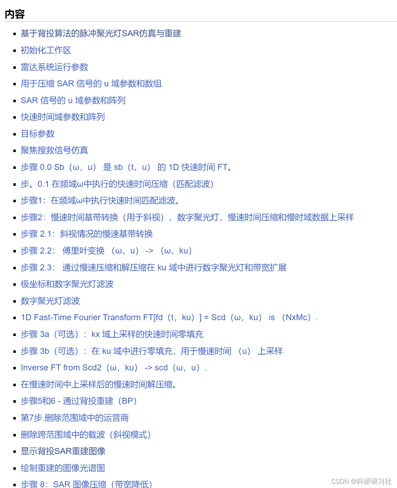
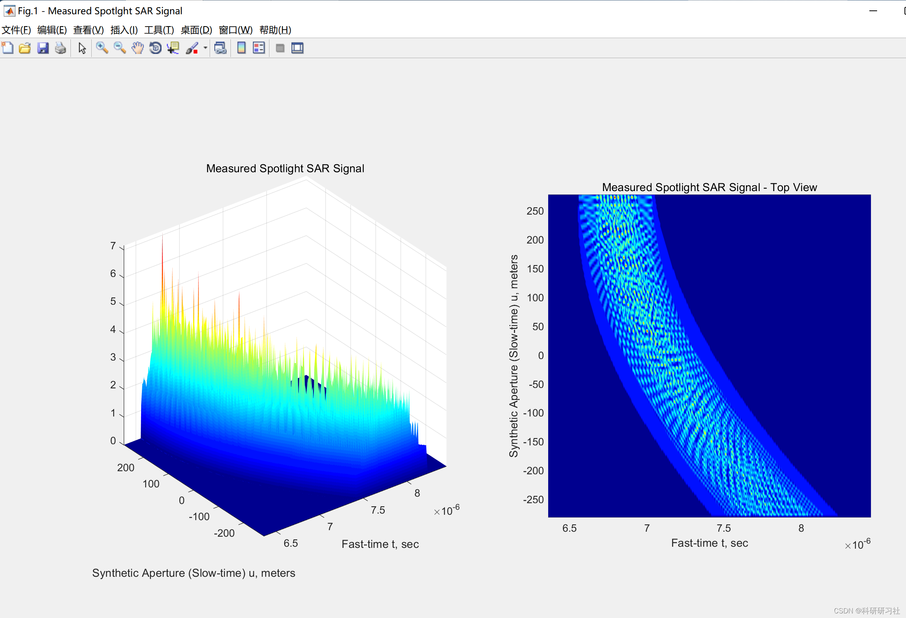
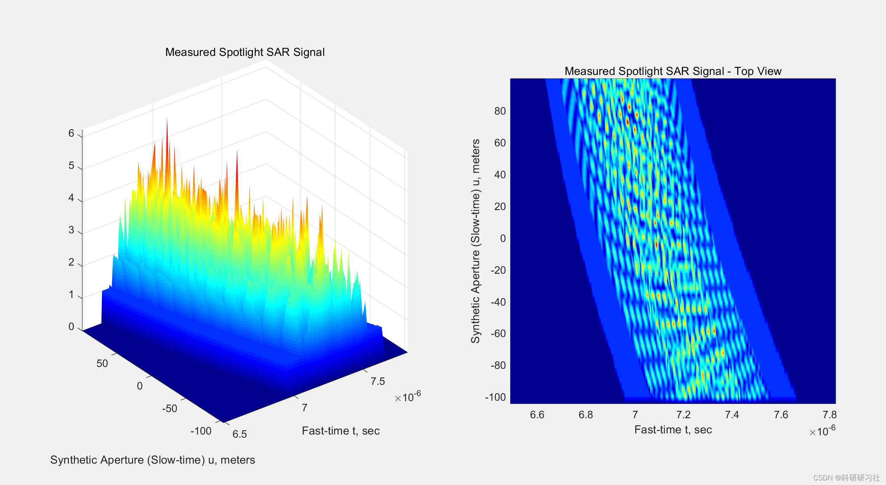
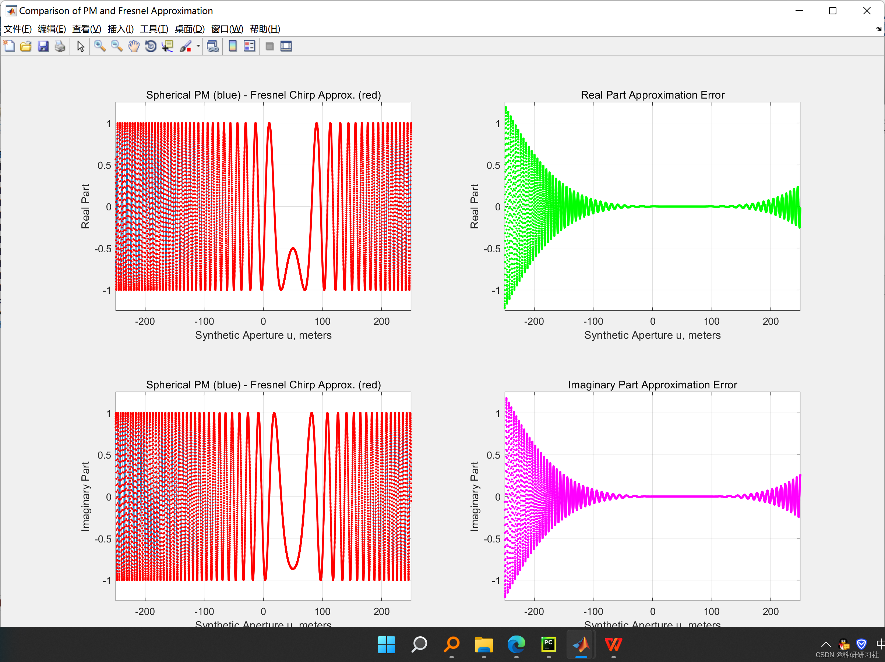
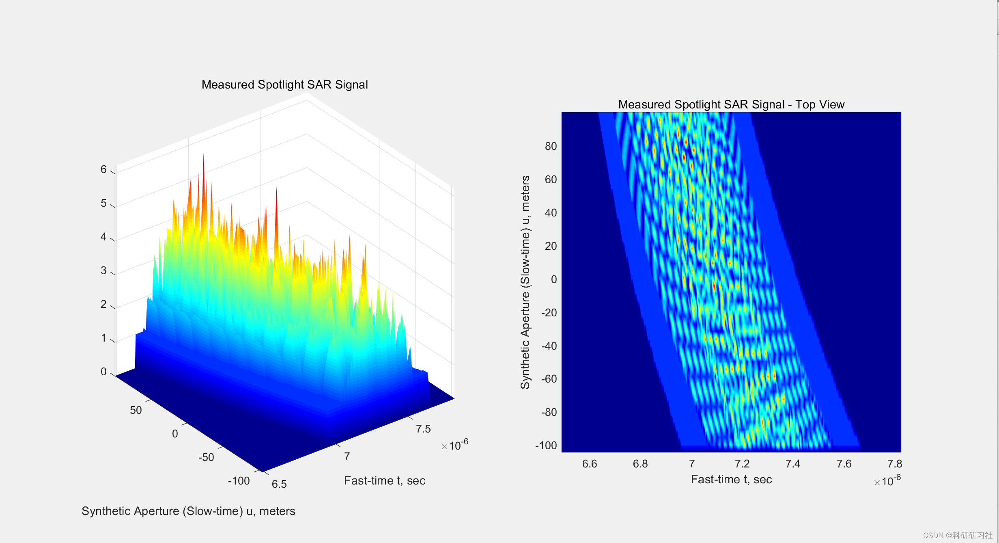
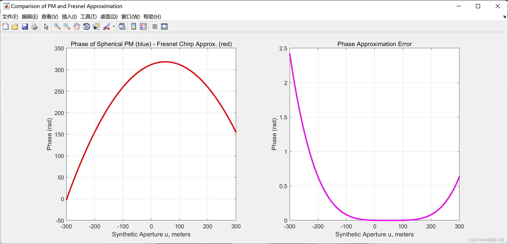

# Signal Processing - Synthetic Aperture Radar (SAR) Signal Processing (Matlab Code Implementation)

​  
1. Overview of Synthetic Aperture Radar (SAR) Image Target Detection and Recognition Technology
The existence of three-dimensional acceleration complicates the geometry of CTSAR's range, thereby increasing the difficulty of signal processing for CTSAR. The imaging algorithm under traditional linear trajectory synthetic aperture radar (LTSAR) is no longer applicable. This project aims to achieve high-resolution imaging with CTSAR, using a real-time imaging processing framework that combines frequency and time-frequency domains. It analyzes the characteristics of CTSAR signals with three-dimensional spatial velocity and acceleration and explores signal focusing techniques. Firstly, based on the geometric model of the CTSAR system, an expression for the range is established. In the mode of curved motion trajectory, by combining the motion characteristics of the SAR platform, according to kinematic theory, the curved motion is decomposed into motion in X, Y, Z axes, each direction having initial velocity and acceleration. A three-dimensional mathematical model is constructed based on the three-dimensional geometric model to establish the function expression for the range history. Due to the complex range model of airborne CTSAR restricting the construction of subsequent imaging algorithms, this paper performs Taylor approximation and Chebyshev approximation separately on the range model, thus reducing the complexity of imaging algorithm design, laying the foundation for research on high-resolution imaging algorithms with CTSAR. Secondly, based on the range of the airborne CTSAR, a echo signal model is established. By utilizing the principle of stationary phase and series inversion method, the echo signal is transformed into two-dimensional frequency domain, obtaining the two-dimensional frequency spectrum expression of the echo signal. The curved trajectory makes the coupling between distance and azimuth in two-dimensional frequency domain more complex, increasing the difficulty of curved SAR imaging processing. To this end, this paper uses Legendre and Chebyshev polynomials to approximate the two-dimensional frequency spectrum orthogonally, aiming to disconnect the coupling and achieve phase compensation. On this basis, an extended frequency domain imaging algorithm suitable for airborne CTSAR is proposed, deriving various order phase compensation functions, achieving high-resolution imaging with curved trajectory SAR and analyzing the quality of focusing. Finally, considering that the traditional Chirp Scaling imaging algorithm cannot meet the requirements of high-resolution imaging with CTSAR's three-dimensional velocity and acceleration, an equivalent Chirp Scaling imaging algorithm matching the three-dimensional curved trajectory range is proposed. The original range is equivalent to the hyperbolic range model under traditional linear motion trajectory mode, plus a range compensation term. This equivalent range ensures imaging resolution. The corresponding echo signal and phase function in the equivalent Chirp Scaling algorithm are derived, and through simulation experiments, it is proven that this algorithm has good imaging quality and meets imaging requirements.
Editor
2. Running results: Here are some of the running results:
Editor
Editor
Editor
Editor
3. Matlab code implementation: Only a part of the code is shown here, all codes can be found in:
%% Fresnel Approximation of a PM Signal by a Chirp Signal\n\n%% Workspace Initialization.\nclc; clear; close all;\n\n%% Radar System Parameters       \nc  = 3e8;            % propagation speed\nfc = 250e6;          % frequency\nlambda = c/fc;       % Wavelength\nk = 2*pi/lambda;     % Wavenumber\nXc = 2e3;            % Range distance to center of target area\n\n%% Case 1: Broadside Target Area\nL  = 300;             % synthetic aperture is 2*L\nY0 = 100;             % target area in cross-range is within [Yc-Y0,Yc+Y0]\nYc = 0;               % Cross-range distance to center of target area\ndu = 0.05;\nu = -L:du:L;\nxn = Xc;\nyn = 50;\n\n%% Signal Definitions - Fresnel Approximation \n% $$\exp[-j2k \sqrt{x_n^2 + (y_n - u)^2}] \approx \exp\Bigg[-j2kx_n -\n% j\frac{k(y_n - u)^2}{X_c}\Bigg]$$\n\n%%%%%%%%%%%%%%%%%%%%%%%%%%%%%%%%%%%%%%%%%%%%%%%%%%%%%%%%%%$%\n%   Program to compare between the original PM signal and  %\n%   Fresnel Approximation                                  %\n%%%%%%%%%%%%%%%%%%%%%%%%%%%%%%%%%%%%%%%%%%%%%%%%%%%%%%%%%%$%\n\n% Original Spherical PM Signal:\nPM = exp(-1i*2*k*sqrt(xn^2+(yn-u).^2));\n\n% Fresnel Chirp Approximation:\nFA = exp(-1i*2*k*(xn+((yn-u).^2)/Xc/2));\n\n%% Plot the Spherical PM and Chirp Approximation Signals.\nh1 = figure('NumberTitle', 'off','Name','Comparison of PM and Fresnel Approximation', ...\n            'Position', [100 0 1200 1000]);\n\nsubplot(2,2,1)\nplot(u,real(PM))\ntitle('Spherical PM (blue) - Fresnel Chirp Approx. (red)')\nhold on;\nplot(u,real(FA),'r.')\nxlabel('Synthetic Aperture u, meters')\nylabel('Real Part')\naxis([-250 250 1.25*min(real(PM)) 1.25*max(real(PM))]);\ngrid on;\n\nsubplot(2,2,2)\nplot(u,real(PM) - real(FA),'g.')\nxlabel('Synthetic Aperture u, meters')\nylabel('Real Part')\ntitle('Real Part Approximation Error')\ngrid on;\naxis([-250 250 1.25*min(real(PM)) 1.25*max(real(PM))]);\ngrid on;\n\nsubplot(2,2,3)\nplot(u,imag(PM))\nhold on;\nplot(u,imag(FA),'r.')\ntitle('Spherical PM (blue) - Fresnel Chirp Approx. (red)')\nxlabel('Synthetic Aperture u, meters')\nylabel('Imaginary Part')\naxis([-250 250 1.25*min(imag(FA)) 1.25*max(imag(FA))]);\ngrid on;\n\nsubplot(2,2,4)\nplot(u,imag(PM) - imag(FA),'m.')\nxlabel('Synthetic Aperture u, meters')\nylabel('Imaginary Part')\ntitle('Imaginary Part Approximation Error')\ngrid on;\naxis([-250 250 1.25*min(imag(FA)) 1.25*max(imag(FA))]);\ngrid on;\n\n%% Phase Comparison\nh2 = figure('NumberTitle', 'off','Name','Comparison of PM and Fresnel Approximation', ...\n            'Position', [100 0 1200 500]);\n\nsubplot(1,2,1)\nplot(u,unwrap(angle(PM)))\nhold on;\nplot(u,unwrap(angle(FA)),'r.')\ntitle('Phase of Spherical PM (blue) - Fresnel Chirp Approx. (red)')\nxlabel('Synthetic Aperture u, meters')\nylabel('Phase (rad)')\ngrid on;\n\nsubplot(1,2,2)\nplot(u,unwrap(angle(PM)) - unwrap(angle(FA)),'m.')\nxlabel('Synthetic Aperture u, meters')\nylabel('Phase (rad)')\ntitle('Phase Approximation Error')\ngrid on;\n  
4. References
[1] Xia Yu. Algorithms and Real-Time Processing for Target Detection and Recognition in SAR Images [D]. University of Electronic Science and Technology of China, 2022. DOI: 10.27005/d.cnki.gdzku.2022.002238.
[2] Meng Tingting. Signal Processing and Imaging Research on Curve Trajectory SAR [D]. Overseas University, 2020. DOI: 10.27155/d.cnki.ghqiu.2020.001178.

## Images

<!-- PAYMENT_BLOCK -->

## Get this dataset

- Payment link (Stripe): [Buy now](https://buy.stripe.com/3cs8yP7sY87d0vu9AB)
- Payment QR code: 

<!-- /PAYMENT_BLOCK -->
